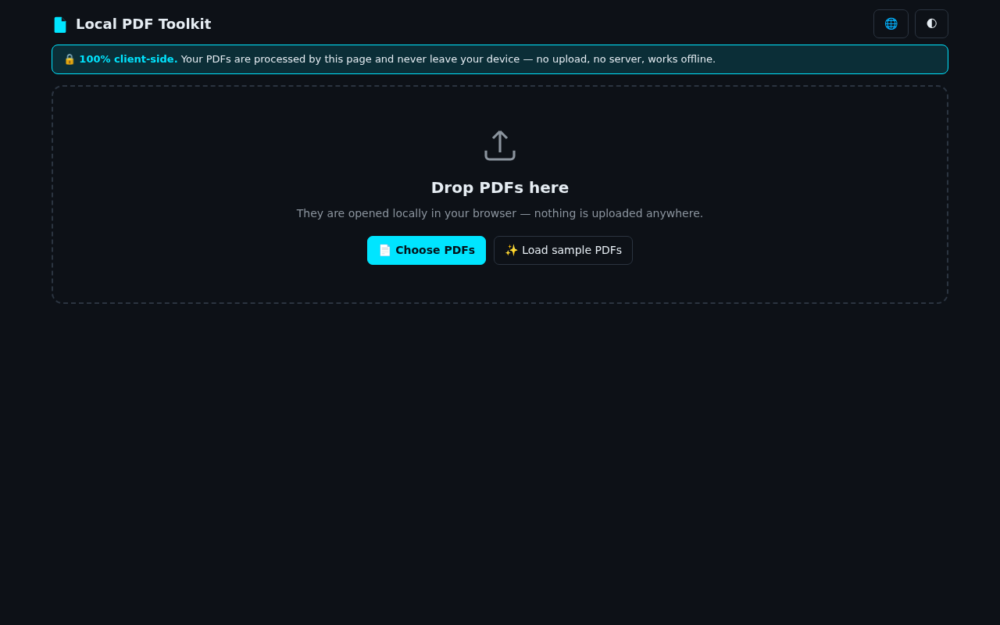
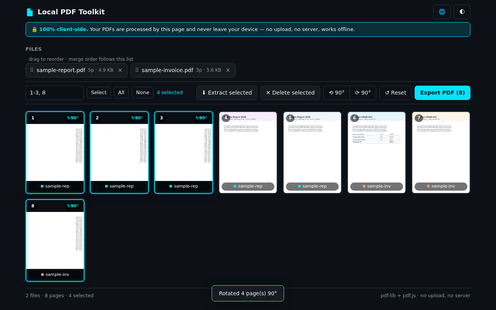
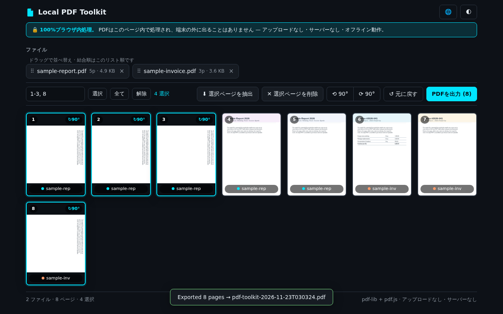

# Local PDF Toolkit

**Merge, split, extract, rotate and reorganize PDFs — without uploading them anywhere.** Everything runs in your browser: no server, no account, no file size queue, and it keeps working offline.

| Drop PDFs — nothing leaves your device | Select · rotate · reorganize pages |
| --- | --- |
|  |  |

## Why

Most "free PDF tools" ask you to **upload contracts, invoices and IDs to their servers** first. The self-hosted alternative (Stirling-PDF) is excellent but wants a Docker box. **Local PDF Toolkit is the middle path**: open a URL, drop files, get results — with the processing happening entirely on your own device.

- 🔒 **Zero upload** — files are read with the browser's File API and processed in-page by [pdf-lib](https://github.com/Hopding/pdf-lib) + [pdf.js](https://github.com/mozilla/pdf.js)
- 📴 **Offline-capable PWA** — after the first visit it works with the network off
- 🌐 **Runs anywhere** — no special browser API needed: Chrome, Edge, Firefox and Safari all work
- 🧾 **No limits by design** — no queue, no "upgrade to merge bigger files"; the only ceiling is your device's memory

## Features

- **Merge** any number of PDFs — drag the file chips to set the order
- **Extract** selected pages into a new document (click, shift-click, or type `1-3, 5, 8-`)
- **Delete** selected pages
- **Rotate** pages left/right in 90° steps (rotation stacks on the page's original orientation)
- **Page grid with live thumbnails** rendered by pdf.js, lazily as you scroll
- **One-click reset** back to the original page order
- **Sample PDFs included** — try every feature before dropping anything real
- English / 日本語 UI, dark / light theme, fully responsive, installable as an app

## Try it

- **Hosted:** https://shunichi19990314-oss.github.io/local-pdf-toolkit/ — press **✨ Load sample PDFs** if you don't have a file at hand
- **Local:** `npm install && npm run dev` → http://localhost:5173
- **Self-host:** `npm run build` and serve `dist/` from any static host (the build is fully relative — works in any sub-path)

### Typical workflows

| Goal | Steps |
| --- | --- |
| Merge two PDFs | Drop both → drag chips into order → **Export PDF** |
| Keep only pages 1, 4–6 | Type `1, 4-6` → Select → **⬇ Extract selected** → Export |
| Remove a blank page | Click its card → **✕ Delete selected** → Export |
| Fix a sideways scan | Select the page (empty selection = all) → **⟳ 90°** → Export |

## Privacy

- No network requests at all after the page loads (check the Network tab — your PDFs never appear in it)
- No cookies, no analytics, no localStorage beyond your UI preferences (language/theme)
- Want proof? Disconnect from the internet, reload, and keep editing

## 日本語

**アップロード不要のPDF編集ツール**です。結合・抽出・削除・回転・並べ替えを、すべてブラウザ内で処理します。ファイルが端末の外に出ることはありません。

| ページ編集画面(日本語UI) |
| --- |
|  |

- **結合**: 複数PDFをドラッグで順番を指定して1つに
- **抽出・削除**: ページをクリック、または `1-3, 5, 8-` のような範囲指定で選択
- **回転**: 90°ステップで回転(元の向きに加算されます)
- **サムネイル付きページグリッド**(pdf.js描画・スクロールに応じた遅延描画)
- **サンプルPDF同梱** — 実ファイルを置く前に全機能を試せます
- **オフライン対応PWA** — 一度開けばネットワークを切っても動作します

大手の無料PDFツールは「まずサーバーへアップロード」が前提です。本ツールは契約書・請求書・身分証のような機密文書を手元のまま処理したい人のための、もう一つの選択肢です。

## Technical notes

- Vanilla TypeScript + Vite; **no UI framework** — the editor state is a pure page-reference sequence (`src/core/sequence.ts`), every operation is an immutable transform, and export rebuilds the PDF from that sequence with `pdf-lib`
- 18 unit tests cover the range parser, sequence transforms and real pdf-lib round-trips (extract/reorder/rotate/merge) — `npm test`
- Service worker (`public/sw.js`) is a small runtime cache — no build-time asset list to maintain

## Related

From the same author: [OpenSCQ30 Web](https://github.com/shunichi19990314-oss/openscq30-web) (control earbuds from the browser) · [Web Serial Console](https://github.com/shunichi19990314-oss/web-serial-console) (serial terminal in the browser) — same philosophy: **your data stays in your browser**.

MIT License · PDF handling by [pdf-lib](https://github.com/Hopding/pdf-lib) (MIT) and [pdf.js](https://github.com/mozilla/pdf.js) (Apache-2.0)

⭐ If this saved you an upload, a star helps others find it.
